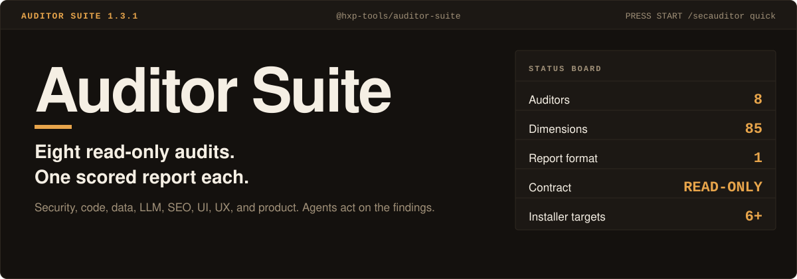
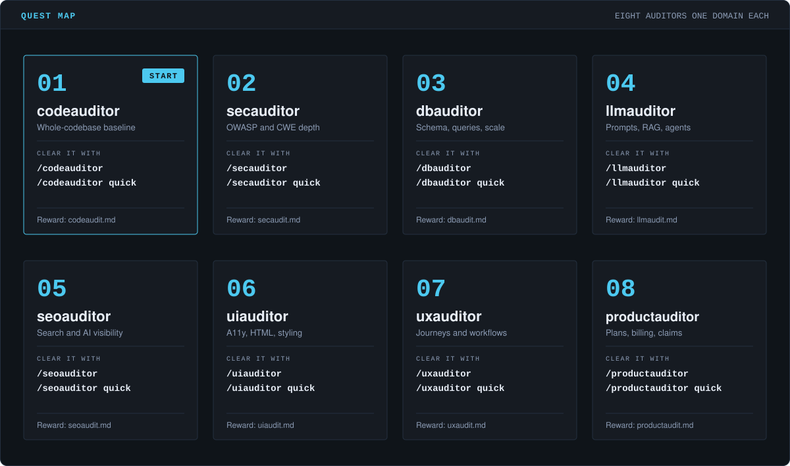
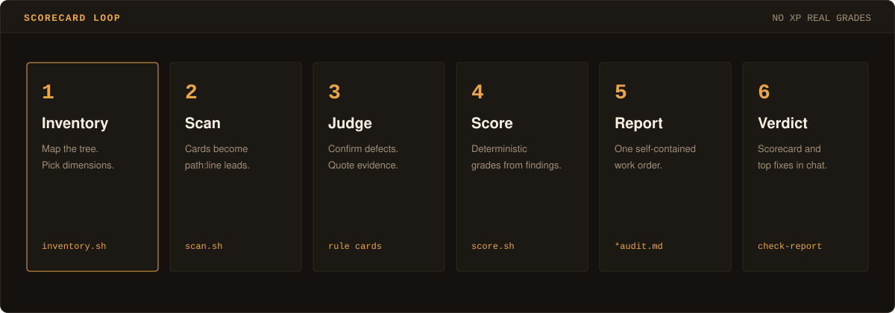

<p align="center">
  
</p>

<p align="center">
  <a href="https://github.com/hannsxpeter/auditor-suite/actions/workflows/lint.yml"></a>
  <a href="https://www.npmjs.com/package/@hxp-tools/auditor-suite"></a>
  <a href="https://github.com/hannsxpeter/auditor-suite/releases/tag/v1.3.2"></a>
  <a href="VERSION"></a>
  <a href="SUITE.md"></a>
  <a href="LICENSE"></a>
</p>

<h3 align="center">Eight read-only audits for AI coding agents.</h3>

<p align="center"><em>You ask. The auditor scores. Another agent can fix from the report alone.</em></p>

Each auditor owns one domain, reads the repo without changing it, writes a prioritized `<name>audit.md`, and prints the verdict in chat. Works on small and frontier models. Implements the [Agent Skills standard](https://agentskills.io). Sibling of [`ready-suite`](https://github.com/hannsxpeter/ready-suite).

Ten-minute proof: [Quick Proof](docs/quick-proof.md).

---

## Press start

```bash
npx @hxp-tools/auditor-suite@latest
```

That installs every auditor into the harnesses it detects (Claude Code, Codex, Cursor, Agent Skills / pi / OpenClaw). Then, inside your agent, clear the first level:

| Host | First run | Then |
|---|---|---|
| Claude Code | `/secauditor quick` | `/codeauditor quick`, or a full `/secauditor` |
| Codex | `$secauditor quick` | `$codeauditor quick` |
| Other slash hosts | `/secauditor quick` | `/codeauditor quick` |

Uninstall:

```bash
npx @hxp-tools/auditor-suite@latest --uninstall
```

### Claude Code plugin (alternative)

Pick one install method per host. Do not combine `npx` and the plugin on the same Claude Code install.

```text
/plugin marketplace add hannsxpeter/auditor-suite
/plugin install auditor-suite@auditor-suite
```

Want only one auditor? `/plugin install secauditor@auditor-suite`.

### From source

```bash
git clone https://github.com/hannsxpeter/auditor-suite.git
bash auditor-suite/install.sh
```

---

## The quest map

Eight auditors. One domain each. Run the ones that match your stack; run several for a full-product review. Each report stands alone.

<p align="center">
  
</p>

| Level | Clear it with | Reward |
|---|---|---|
| 1. codeauditor | `/codeauditor`, `/codeauditor quick` | `codeaudit.md` |
| 2. secauditor | `/secauditor`, `/secauditor quick` | `secaudit.md` |
| 3. dbauditor | `/dbauditor`, `/dbauditor quick` | `dbaudit.md` |
| 4. llmauditor | `/llmauditor`, `/llmauditor quick` | `llmaudit.md` |
| 5. seoauditor | `/seoauditor`, `/seoauditor quick` | `seoaudit.md` |
| 6. uiauditor | `/uiauditor`, `/uiauditor quick` | `uiaudit.md` |
| 7. uxauditor | `/uxauditor`, `/uxauditor quick` | `uxaudit.md` |
| 8. productauditor | `/productauditor`, `/productauditor quick` | `productaudit.md` |

In Codex the same skills invoke with a `$` prefix: `$codeauditor`, `$secauditor`, and so on.

The game layer is a map, not a scoreboard. There are no points or XP. The real grades are the numeric scores each full audit computes from its findings.

<details>
<summary>What each auditor owns</summary>

| Skill | Audits | Dimensions |
|---|---|---|
| **[codeauditor](skills/codeauditor)** | Whole codebase: security survey, architecture, quality, testing, errors, performance, dependencies, docs, observability | 9 |
| **[secauditor](skills/secauditor)** | Security vulnerabilities, grounded in OWASP and CWE | 11 |
| **[dbauditor](skills/dbauditor)** | Database layer: schema, relationships, constraints, types, indexing, queries, transactions, migrations, protection, search, scale | 11 |
| **[llmauditor](skills/llmauditor)** | LLM integration: trust boundaries, prompts, models, APIs, reliability, output, cost, latency, eval, observability, RAG, agents | 12 |
| **[seoauditor](skills/seoauditor)** | Search and AI answer-engine visibility (SEO, GEO, AEO) | 12 |
| **[uiauditor](skills/uiauditor)** | UI implementation: accessibility, semantics, styling, components, responsive layout, performance, design system, assets, i18n, native UI | 10 |
| **[uxauditor](skills/uxauditor)** | Product UX: user journeys, processes, and workflows end to end | 11 |
| **[productauditor](skills/productauditor)** | Business layer: claims, plans, billing, accounts, metrics, KPIs, release and sunset, experiments, feedback | 9 |

Boundaries between auditors: [SUITE.md](SUITE.md).

</details>

---

## Scorecard loop

Every auditor uses the same loop. The model judges; the scripts keep score.

<p align="center">
  
</p>

1. **Inventory** maps the project and decides which dimensions apply.
2. **Scan** turns rule cards into `path:line` leads.
3. **Judge** confirms defects from the cards and quotes evidence.
4. **Score** computes every grade from the findings (deterministic).
5. **Report** is one self-contained work order at the repo root.
6. **Verdict** prints the scorecard and highest-leverage fixes in chat.

### Modes

Every auditor takes the same arguments after its name:

- nothing or `full`: every dimension that applies, every check.
- `quick`: only the Critical-class checks, no numeric score. Fast triage; best first pass for small models or huge repos.
- `only=DIM,DIM`: a subset of dimensions (for example `/secauditor only=AUTHZ,INJ`), with a partial score.
- a path, alone or after a mode (`/dbauditor quick services/billing`): audit only that part of the tree.

### The read-only contract

1. **Never edits source.** An audit changes nothing except its own report file.
2. **Never runs the live system.** No app runs, tests, builds, browsers, live database connections, model calls, exploits, or crawls. Only read-only commands: the bundled scripts and inspection such as `git log`.
3. **Evidence it opened.** Every finding cites a `path:line` and quotes the code there; the validator checks it.
4. **One self-contained report.** Each run writes exactly one `<name>audit.md` at the repo root, in one format shared by all eight.
5. **Verdict in chat.** After the report validates, the auditor prints the score, the scorecard, and the top fixes.

Design detail: [docs/ARCHITECTURE.md](docs/ARCHITECTURE.md). Authoring a new auditor: [docs/AUTHORING.md](docs/AUTHORING.md).

---

## Why eight, not one

A single mega-auditor flattens every domain into generic advice. Splitting the work gives each auditor room to be opinionated: its own dimensions and weights, its own rule cards and paper controls, and a tight trigger surface so the harness routes precisely.

---

## Developing from this repo

```bash
bash scripts/lint.sh --verbose
bash tests/run.sh
bash tests/lint-selftest.sh
```

Maintainer rituals: [MAINTAINING.md](MAINTAINING.md). Contributors: [CONTRIBUTING.md](CONTRIBUTING.md). Suite map: [SUITE.md](SUITE.md).

`git pull` updates every installed skill when you installed from a clone, because each harness reads the clone through links. After an `npx` install, re-run `npx @hxp-tools/auditor-suite@latest` to refresh `~/.auditor-suite` and re-link. A release that adds an auditor needs one more install pass to link the new skill.
